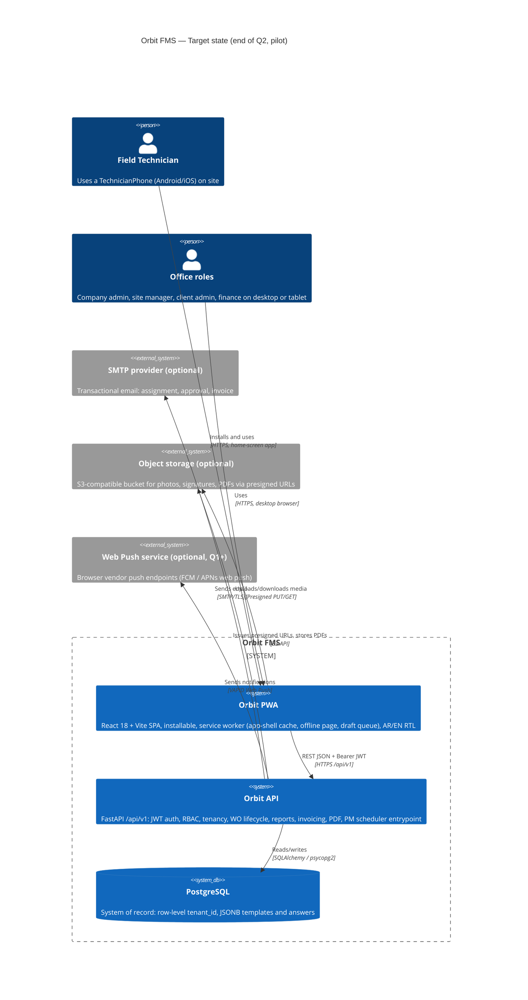

# Orbit FMS — Architecture Vision (Pilot cycle)

> **Status:** Active · **Owner:** Solution Architect (review) / Tech Lead (execution) · **Cycle:** 2026-Q4 → 2027-Q3
> **Companion:** [MOBILE_FIRST_ADR_NOTES.md](MOBILE_FIRST_ADR_NOTES.md) · [../ARCHITECTURE.md](../ARCHITECTURE.md) (system reference) · [RBAC.md](RBAC.md)

---

## 1. Scope

Get Orbit into technicians' hands in the field as a mobile-first, installable PWA on the existing React + FastAPI + Postgres stack, while keeping full desktop support for office roles.

---

## 2. Principles

1. **Phone is the base layout; desktop is the enhancement.** Design every technician screen at 360px first, then add columns, tables, and side panels from `md:`/`lg:` breakpoints up. Admin and finance screens stay desktop-first, but they must still work on a phone.
2. **Keep the stack, change the shell.** React 18 + Vite + Tailwind + react-router + i18next on the front end and FastAPI + Postgres on the back end stay as they are. We spend effort on how the app is delivered (PWA, service worker, install) and on field UX, not on swapping frameworks.
3. **Reach native capability through the web first.** Camera via `<input capture>`, geolocation, install-to-home-screen and Web Push cover the pilot's needs. A native shell is only justified by a measured gap that the web platform cannot close.
4. **Online-first, failure-tolerant, offline later.** Q0 and Q1 assume connectivity but never lose a technician's typed work. Local draft persistence comes before any sync engine, and real offline sync is earned with evidence from the field.
5. **One API contract for every client.** The `/api/v1` REST surface stays the single integration point. No backend-for-frontend layer and no client-specific endpoints unless a measured payload or latency problem requires one.
6. **Bilingual and RTL-correct on every surface.** Arabic is the default. Logical Tailwind properties (`ms-`/`me-`/`ps-`/`pe-`) are mandatory in new mobile components, and the PWA manifest, install prompts, and offline page are all localized.
7. **Make it boring to operate.** One deployable API, one static web bundle, one Postgres. Secrets never live in the repo. Every new runtime component (worker, queue, object store) needs an explicit trigger and an AgDR.

---

## 3. Target-state architecture (C4 Level 1 — System Context)

**Reading the diagram.** There is deliberately no worker tier, no Redis, no API gateway, and no mobile-native client. The existing [ARCHITECTURE.md §2.1](../ARCHITECTURE.md) shows those as long-range targets. This vision defers them until a stated trigger fires (see §4 and §6). Optional externals can be switched on per tenant or environment through configuration. The system must run correctly when they are absent: email falls back to in-app notifications, and media falls back to DB/local storage.

---

## 4. Current vs target

| Dimension | Current (Oct 2026, observed in repo) | Target (end of Q2) | Trigger to go further |
|---|---|---|---|
| **Data** | Postgres with row-level `tenant_id`; Alembic plus frozen `schema_ensure` ([AgDR-SCHEMA-ENSURE](../decisions/AgDR-SCHEMA-ENSURE.md)); media stored local/DB-backed | Same Postgres. Alembic is the only migration path for new changes. Media moves to S3-compatible storage behind presigned URLs. Field-friendly indexes on `(tenant_id, assignee_user_id, status)` | Postgres RLS when the tenant count exceeds the pilot or a security review requires DB-level isolation |
| **Auth** | JWT access + refresh in `localStorage`; FastAPI owns login (Supabase Auth explicitly unused) | Same token model plus silent refresh that survives PWA resume and backgrounding. Longer refresh TTL for technicians, with server-side revocation. Logout clears the SW cache and draft store | Move to httpOnly cookie sessions if an XSS finding or a pen-test requires it |
| **Deployment** | Five docker-compose profiles (local, demo, hybrid, prod, supabase-demo); nginx serves `dist/`; Cloudflare Tunnel for the demo; GitHub Actions `ci.yml` + demo deploy | One documented **prod** path and one **demo** path; the other profiles are archived or documented as dev-only. nginx sends correct `Cache-Control` for `sw.js` (no-cache) and hashed assets (immutable). HTTPS everywhere (a PWA requirement) | Container orchestration only when there is more than one API replica |
| **Observability** | Python `logging`, a health route in `main.py`, no frontend error capture, no RUM | Structured JSON logs with request-id and tenant-id. Frontend error capture (a Sentry-class tool, to be chosen by AgDR). Basic field telemetry: install rate, report-save failures, p75 page load on 4G | Metrics stack (Prometheus/Grafana) at more than one API replica or when an SLO is defined |
| **Frontend shell** | React 18 SPA with a desktop-oriented layout and sidebar; technician screens are "mobile-friendly" rather than mobile-designed | Responsive app shell: bottom tab bar on phones (My Work / Scan / Notifications / Me), sidebar from `lg:` up. 44px touch targets. Technician routes designed at 360px | — |
| **PWA** | Icons in `public/icons/` and an uncommitted `InstallOrbitBanner` / `usePwaInstall`. **No manifest link in `index.html`, no service worker** | `manifest.webmanifest` (localized name, `display: standalone`, maskable icons). Service worker for app-shell precache, offline fallback page, and update prompt. Install banner wired in. Lighthouse PWA installable check passes | Web Push in Q1 if notification latency matters to the pilot |
| **Async / PM jobs** | No workers; PDF and email run inline in API requests; PM generation via `backend/scripts/run_maintenance_job.py` (cron-invoked); in-memory WebSocket fan-out in `realtime.py` (single process) | PM job runs on a documented schedule (host cron or a compose sidecar) and is idempotent and logged. PDF and email stay inline but have timeouts. WebSocket stays single-process, with a polling fallback for the PWA on resume | Introduce a queue (RQ/Celery + Redis) when p95 PDF generation exceeds 5s, email failures block requests, or a second API replica breaks in-memory WebSockets |
| **Secrets** | `.env` files per profile; `backend/.env` is gitignored, **but `deploy/demo/.env.supabase-demo` is untracked and not gitignored**; demo runbook keeps placeholders in a worksheet | All real `.env*` files gitignored (only `*.example` committed). Secrets injected by the host or CI secrets store. `SECRET_KEY` and DB credentials rotated after the demo. Secret scanning on in CI | Managed secrets store (cloud KMS or Vault) at the first paying tenant |

---

## 5. Migration path

Each milestone ends in a **go/no-go review** against the exit criteria. A failed exit criterion means extending the quarter, not skipping ahead.

### Q0 — Cleanup + PWA foundation (2026-Q4)

- **Hygiene:** gitignore every real `.env*` and keep only `*.example` files in git; rotate any credential that touched the working tree; consolidate the compose profiles into prod + demo + local; commit or delete stray artifacts (`nnn.md`, `debug-*.log`, `tsconfig.tsbuildinfo` noise).
- **PWA baseline:** manifest plus `<link rel="manifest">` and `theme-color` in `index.html`; service worker (via `vite-plugin-pwa`/Workbox, chosen by AgDR) with app-shell precache, offline page, and a "new version available" prompt; wire in `InstallOrbitBanner`; nginx cache headers.
- **Auth resilience:** refresh on resume (`visibilitychange`); clear caches on logout.
- **Exit:** the app installs on Android Chrome and iOS Safari; Lighthouse "installable" passes; no secrets in `git status`; one documented prod deploy.

### Q1 — Mobile shell + field work-order flow (2027-Q1)

- Responsive app shell with a bottom tab bar on phones.
- Technician journey designed at 360px: My Work list, then WO detail, then start/hold/complete, then report editor (camera capture, signature, measurements), then submit.
- Draft autosave to `IndexedDB` alongside the server PUT, so a dropped connection or tab kill never loses a report.
- Media moves to presigned uploads; images are downscaled client-side before upload.
- Optional: Web Push for assignment and approval (AgDR required).
- **Exit:** a pilot technician completes a WO end to end on a phone without needing a desktop; zero lost-draft incidents over 2 weeks of pilot; p75 WO-detail load under 2.5s on 4G.

### Q2 — Offline-lite (2027-Q2)

- Read-through cache of the technician's assigned WOs and their templates, so a WO can be opened with no signal.
- Outbox queue for **report drafts and status transitions only**, using idempotency keys and server-side last-write-wins plus conflict flagging. No offline creation of WOs, invoices, or admin entities.
- Clear UI for sync state ("Saved on device / Synced / Needs attention").
- **Exit:** a technician can finish a report in a no-signal plant room and it syncs within 1 minute of reconnecting; conflict rate under 1% of submissions.

### Q3 — Native reconsideration checkpoint (2027-Q3)

- This is a decision gate, not a build milestone. Using pilot telemetry, evaluate whether a native shell (Capacitor wrapper first, RN only if Capacitor fails) is justified.
- **Go criteria (any of):** iOS PWA limitations block a must-have (background sync, reliable push, Bluetooth/NFC asset tags); a customer procurement requirement for store distribution; install/retention data showing the PWA is the adoption bottleneck.
- **Output:** an AgDR recording keep-PWA vs wrap-in-Capacitor vs native, with the field evidence attached.

---

## 6. Anti-scope

| Out of scope | Rationale | Reconsider when |
|---|---|---|
| **Native app now** (Capacitor, React Native, Flutter) | It doubles the release surface (stores, signing, review delays) before we know which device capabilities technicians actually need. The PWA covers camera, location, install, and (on most platforms) push. The existing RN plan in ARCHITECTURE.md §8.3 is superseded for this cycle | The Q3 checkpoint go criteria are met with pilot evidence |
| **Maximo / ManWinWin full parity** | Enterprise CMMS suites carry decades of breadth (inventory, procurement, MRO, reliability analytics). Chasing parity dilutes the pilot wedge, which is fast field reporting leading to approved reports and then invoices, for Arabic-first FM contractors | A paying customer contract names a specific module as a deal-breaker. Even then, build that one module rather than parity |
| **Next.js rewrite / SSR** | Orbit is an authenticated SPA with no SEO surface. SSR adds a Node runtime and complicates the service worker and offline story. Vite already gives fast builds and code splitting. A rewrite stalls field delivery for a quarter or more | A public, SEO-relevant surface (marketing site, public client portal) is needed. Build that as a separate app, not a rewrite |
| **Microservices split** | One team, one domain, one database. Splitting adds network failure modes, distributed transactions (WO to report to invoice is a single consistency chain), and ops cost with no scaling need | Independent scaling or deploy cadence is measured as necessary (for example PDF rendering saturating the API). Extract a **worker** first, not a service |
| **Full offline-first sync engine** (CRDTs, PouchDB/RxDB replication) | Too complex for the evidence we have. Offline-lite (Q2) covers the realistic dead-zone case | Q2 telemetry shows technicians spend a large share of shifts fully offline |
| **Backend rewrite or swap** (async SQLAlchemy migration, other framework) | The sync FastAPI + SQLAlchemy stack is tested (219+ pytest) and is not the bottleneck | Profiling shows DB-bound concurrency limits at pilot load |

---

## 7. Review cadence

- **Quarterly**, aligned to the milestone go/no-go in §5. Each review re-checks the current-vs-target table, moves rows that are done, and re-evaluates every anti-scope "reconsider when" trigger against actual data.
- **Out-of-cycle review** happens if any anti-scope trigger fires, a security finding changes the auth or secrets posture, or the pilot customer's requirements change materially.
- **Next scheduled review:** 2027-01 (Q0 exit).

---

## 8. Educational parallel — how this vision teaches architecture judgment

This document is meant to be reusable as a teaching artifact. Each section practises one habit:

- **Scope in one sentence:** if you can't state it in one sentence, you don't have a decision yet, you have a wish list.
- **Principles before technology:** "phone is the base, desktop is the enhancement" settles a hundred future layout arguments. Picking a library settles none of them.
- **Current vs target with triggers:** the most valuable column in §4 is "Trigger to go further". It turns "we'll need Redis someday" into a testable condition. Without it, debt either gets ignored or gets built early. The table also grounds the target in the repo as it actually is today (for example, it records that no service worker exists) rather than the repo as we assume it to be.
- **Progressive capability, not big-bang:** Q0 to Q3 moves from cheap and reversible (manifest, cache headers) to expensive and less reversible (offline sync, native shell). The most irreversible choice is placed last, where it has the most evidence behind it. This is the "last responsible moment" principle.
- **Anti-scope is a decision, not an omission:** writing down "not Next.js, not microservices, not native" with a reconsider-when condition protects the team from scope creep. It also stops the opposite failure, where an option is dismissed forever because nobody wrote down when it would make sense.
- **Evidence gates:** Q3 is a checkpoint, not a feature. Architecture judgment means knowing which questions the pilot has to answer before you commit, and instrumenting the system (§4 Observability) so those answers will exist.

---

*Generated for /tech-vision cycle on 2026-10-21. Operator should refresh with /tech-vision when revisiting.*
