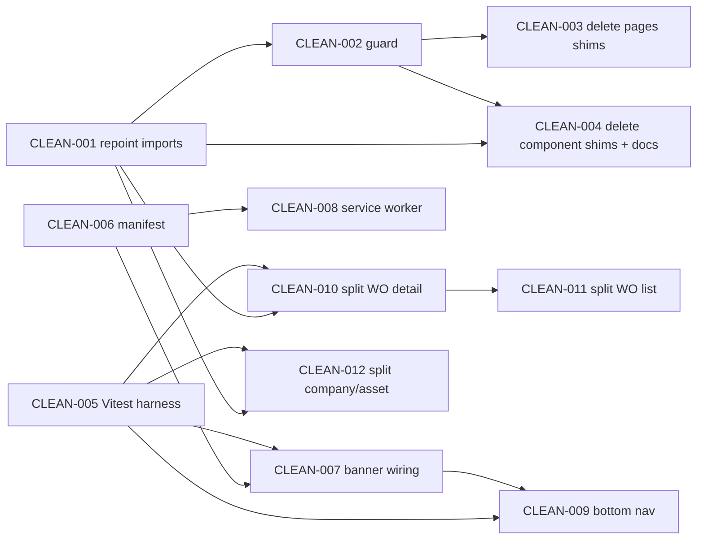

# Mobile-first cleanup & delivery plan — Orbit FMS

**Author:** Tech Lead (Hisham) · **Date:** 2026-10-21 · **Status:** Proposed (wave 2A)  
**Parent:** [MOBILE_FIRST_CYCLE.md](./MOBILE_FIRST_CYCLE.md) · **Tests:** [CLEANUP_TEST_CASES.md](./CLEANUP_TEST_CASES.md) · **Tickets:** [tickets/](./tickets/)

**Operator decisions (locked):**

| ID | Decision |
|----|----------|
| 1A | Pilot ships as **responsive web + installable PWA**. Desktop layouts (`lg+`, ≥1024px) stay first-class and unchanged. |
| 1C | Native shell (Capacitor / React Native) is **deferred** — later horizon only. |
| 2A → 2B → 2C | Delivery order: **docs** → **cleanup PRs** → **mobile shell start**. |

---

## 1. Goals

1. **One import path per module.** Every feature imports from its canonical home (`@/features/<domain>/…` or `@/shared/…`). No code path goes through the legacy `src/pages` / `src/components` re-export layer.
2. **Remove the legacy mirror safely.** Delete the 49 shim files once nothing depends on them, and stop it coming back with an automated guard.
3. **Make Orbit installable on a phone.** Web app manifest, icons, theme meta, a minimal service worker, and the existing `InstallOrbitBanner` wired into the shell with AR/EN copy.
4. **Start the mobile shell.** Bottom tab navigation below `lg` with a "More" sheet; the desktop sidebar stays as-is at `lg+`.
5. **Make god-page splits possible and safe.** Add a unit-test harness, then split `WorkOrderDetailPage` (1474 lines) and the other large pages behind characterization tests. These splits come after the shell and do not block the pilot.

## 2. Non-goals

- Native shell (Capacitor / RN), push notifications, or app-store distribution (1C, later horizon).
- Offline **data** (queued writes, offline work-order editing). The service worker caches the app shell only; it never caches `/api/*`.
- Redesigning desktop layouts or changing the sidebar at `lg+`.
- Removing the `@/lib` → `src/shared/lib` alias in `vite.config.ts`. It's another path alias, but it's widely used and harmless; it gets a separate ticket if wanted.
- Splitting the i18n monolith (`src/i18n/locales/*.json`), which CLEANUP_STAGE C3 already deferred.
- Backend changes. This plan is frontend-only.
- ManWinWin feature parity.

## 3. Current-state diagnosis (verified 2026-10-21 on `main` @ `d6b0175`)

### 3.1 Legacy mirror layer

| Location | Files | Content | Internal consumers |
|----------|-------|---------|--------------------|
| `src/pages/*.tsx` | 20 | 2-line `@deprecated` re-exports → `@/features/*/pages/*` | **0**. `src/app/routes.tsx` already imports canonical paths. |
| `src/components/*.tsx` | 29 | 2–3 line `@deprecated` re-exports → `@/shared/components/*` (11) or `@/features/*/components/*` (18) | **36 import lines in 16 files** |

No consumers outside `src/`: `tests/`, `playwright.config.ts`, `vite.config.ts` and `tsconfig*.json` reference neither directory. The package isn't published, so nothing external depends on the shims either.

**Files still importing `@/components/*` (all must be repointed):**

| File | Shimmed imports |
|------|-----------------|
| `features/assets/pages/AssetsPage.tsx` | EmptyState, AssetLifecycleBadge, AssetRegisterModal, AssetImportModal, MaintenanceCalendar, AssetWorkOrderPanel |
| `features/companies/pages/SiteDetailPage.tsx` | EmptyState, AssetLifecycleBadge, AssetRegisterModal, SiteEditModal, SiteQrModal |
| `features/companies/pages/CompanyDetailPage.tsx` | EmptyState, CompanyEditModal, SiteProvisionModal, SiteAssignManagerModal |
| `features/assets/pages/AssetDetailPage.tsx` | AssetLifecycleBadge, AssetLifecycleTimeline, AssetEditModal |
| `features/users/pages/UsersPage.tsx` | EmptyState, UserRoleBadge, ProvisionCredentialsModal |
| `features/work-orders/pages/WorkOrdersPage.tsx` | FilterBar, WorkOrderRequestReviewModal |
| `features/companies/pages/CompaniesPage.tsx` | EmptyState, CompanyCreateModal |
| `features/work-orders/pages/WorkOrderDetailPage.tsx` | WorkOrderRequestReviewModal |
| `features/locations/pages/LocationsPage.tsx` | LocationTree |
| `features/auth/pages/LoginPage.tsx` | OrbitLogo |
| `features/reports/pages/ReportTemplatesPage.tsx` | CategoryObservationsEditor |
| `features/invoices/pages/InvoicesPage.tsx` | InvoicePreviewModal |
| `features/dashboard/pages/DashboardPage.tsx` | StatsCard |
| `features/companies/components/CompanyCreateModal.tsx` | ProvisionCredentialsModal |
| `features/companies/components/SiteProvisionModal.tsx` | ProvisionCredentialsModal |
| `features/companies/components/SiteAssignManagerModal.tsx` | ProvisionCredentialsModal |
| `shared/components/Sidebar.tsx` | OrbitLogo. `shared` reaches back into the legacy layer, which inverts the layering. |

**Decision: remove the shims rather than keep them.** Keeping them has no benefit: there are no external consumers. It does have costs. The shims keep a second, misleading tree alive. `CLAUDE.md` still documents `src/pages/*` as the real page location, so interns and AI agents keep adding to the wrong tree. Every refactor also has to reason about two paths. The fallback, if removal surfaces something unexpected, is to restore a single file from git. That's a two-minute revert, not a design problem.

### 3.2 PWA orphan

| Item | State |
|------|-------|
| `src/features/pwa/usePwaInstall.ts` | Exists, untracked. It handles `beforeinstallprompt`, iOS detection, visit counting (≥2), 2.5s dwell, narrow viewport (≤1023px), and dismiss persistence. |
| `src/features/pwa/InstallOrbitBanner.tsx` | Exists, untracked, **mounted nowhere**. |
| i18n keys `pwa_install_title/body/ios_hint/cta/dismiss` | **Missing** from both `ar.json` and `en.json`. Mounting the banner today would render raw keys. |
| `public/icons/*` (favicon.svg, apple-touch-icon, 192/512, maskable 192/512) | Exist, untracked. |
| `manifest.webmanifest` | **Missing.** |
| `index.html` | Has `viewport` only. No `<link rel="manifest">`, `theme-color`, `apple-touch-icon`, or favicon link. |
| Service worker | **None.** No `vite-plugin-pwa`, no registration. |

### 3.3 Mobile shell today

`Layout.tsx` already gives the shell a responsive drawer: a hamburger button below `lg`, `Sidebar` sliding in with a `max-lg:fixed` overlay, and RTL-aware sides. This works but isn't phone-first. On a phone, primary destinations sit behind two taps, and the header crowds the clock, bell, language toggle, and logout into a single row. Nothing renders at the bottom of the screen yet, so the install banner (`fixed bottom-0`) won't collide with anything until the bottom nav exists. CLEAN-009 must stack the two.

### 3.4 God pages

| File | Lines | Smell |
|------|-------|-------|
| `features/work-orders/pages/WorkOrderDetailPage.tsx` | 1474 | 26 `useState`, ~15 inline `apiFetch` calls, 3 inline modals (report, hold, cancel), transition table and status rules inline, and 6 independent sections (context, report, comments/docs, history, status, invoice) in one component |
| `features/work-orders/pages/WorkOrdersPage.tsx` | 756 | List, filters, request-review and create flows mixed together |
| `features/companies/pages/CompanyDetailPage.tsx` | 653 | Company profile, sites list, and provisioning flows |
| `features/assets/pages/AssetDetailPage.tsx` | 610 | Asset profile, lifecycle, and WO panel |
| (watch) `InvoiceDetailPage` 501, `AssetRegisterModal` 470, `UsersPage` 432 | — | Not in this plan's scope |

### 3.5 Test & CI baseline

- **Unit/component tests:** none. There's no Vitest/Jest in `package.json`.
- **E2E:** Playwright, 5 specs under `tests/e2e/domains/*`, with a single `chromium` (Desktop Chrome) project. **No mobile viewport project.**
- **CI (`ci.yml`, frontend job):** `npm ci && npm run build` only. There's no lint step, and no ESLint is configured.
- **Hygiene:** `tsconfig.tsbuildinfo` is listed in `.gitignore` (line 226) but is **still tracked**, so it shows up modified after every build. The fix is `git rm --cached`.

### 3.6 Navigation source of truth

`Sidebar` filters `NAV_ITEMS` (`src/shared/navigation/navItems.ts`) by `hasAnyRole`, `isPlatformStaff`, and `hasFeature`, after fetching `/users/me` itself. The bottom nav must reuse that exact filter. Otherwise phone and desktop will disagree on what a role can see. CLEAN-009 therefore extracts a pure `getVisibleNavItems(user)` that both navs consume.

---

## 4. Workstreams

| WS | Name | Wave | Tickets | Outcome |
|----|------|------|---------|---------|
| **W1** | Import hygiene & legacy removal | 2B | CLEAN-001, 002, 003, 004 | Single canonical import tree; guard in CI; 49 shims deleted; docs corrected |
| **W2** | Test harness | 2B | CLEAN-005 | Vitest + Testing Library + jsdom; `npm test` in CI |
| **W3** | PWA installability | 2C | CLEAN-006, 007, 008 | Manifest + meta, banner wired with AR/EN copy, app-shell service worker |
| **W4** | Mobile shell | 2C | CLEAN-009 | Bottom tabs + More sheet below `lg`; Playwright mobile projects |
| **W5** | God-page decomposition | Post-pilot (2D) | CLEAN-010, 011, 012 | WO detail ≤ 400 lines; list/company/asset pages split behind tests |

---

## 5. Ticket breakdown

Estimates: **S** ≤ ½ day · **M** 1–2 days · **L** 3–5 days.

| ID | Title | Key acceptance criteria | Est. | Depends on |
|----|-------|-------------------------|------|-----------|
| [CLEAN-001](./tickets/CLEAN-001.md) | Repoint feature/shared imports off `@/components/*` | All 36 import lines in 16 files use canonical paths; `rg "@/components/" src --glob '!src/components/**'` → 0 hits; `npm run build` green; no behaviour change | S | — |
| [CLEAN-002](./tickets/CLEAN-002.md) | Legacy-import guard script + CI step | `npm run check:imports` fails on any `@/components/`, `@/pages/`, or relative import into those dirs; wired into `ci.yml` frontend job; documented | S | CLEAN-001 |
| [CLEAN-003](./tickets/CLEAN-003.md) | Delete `src/pages/` shim directory (20 files) | Directory removed; build + e2e green; guard passes | S | CLEAN-002 |
| [CLEAN-004](./tickets/CLEAN-004.md) | Delete `src/components/` shims + fix docs + untrack build info | 29 files removed; `CLAUDE.md` + `CLEANUP_STAGE.md` layout sections updated; `tsconfig.tsbuildinfo` untracked (`git rm --cached`) | S | CLEAN-001, 002 |
| [CLEAN-005](./tickets/CLEAN-005.md) | Add Vitest + Testing Library harness | `npm test` runs jsdom tests with the `@/` and `@/lib` aliases resolving; one smoke test; CI runs `npm test` | M | — |
| [CLEAN-006](./tickets/CLEAN-006.md) | Web app manifest + icon/theme meta | `public/manifest.webmanifest` valid (name, short_name, start_url `/`, display `standalone`, theme/background colour from tokens, 192/512 + maskable icons); `index.html` links manifest, theme-color, apple-touch-icon, favicon; DevTools → Application → Manifest shows no errors | S | — |
| [CLEAN-007](./tickets/CLEAN-007.md) | Wire `InstallOrbitBanner` + AR/EN copy | 5 `pwa_install_*` keys in `ar.json` + `en.json`; banner mounted once in the authenticated shell; hidden at `lg+`, in standalone mode, and after dismiss; unit tests for `usePwaInstall` gating | S | CLEAN-005, 006 |
| [CLEAN-008](./tickets/CLEAN-008.md) | App-shell service worker (no API caching) | SW registered in production builds only; precaches built assets; navigation fallback to `index.html`; `/api/*` **never** cached (NetworkOnly); update flow defined; Chromium install prompt fires on Android | M | CLEAN-006 |
| [CLEAN-009](./tickets/CLEAN-009.md) | `MobileBottomNav` + More sheet below `lg` | Shared `getVisibleNavItems(user)` drives Sidebar + tabs; ≤1023px: 4 role-aware tabs + More; `lg+`: unchanged sidebar, no tabs; RTL mirrored; safe-area insets; install banner stacks above tabs; Playwright `mobile-chrome` project added and golden path green on it | L | CLEAN-005, 007 |
| [CLEAN-010](./tickets/CLEAN-010.md) | Split `WorkOrderDetailPage` (1474 → ≤400 lines) | Pure rules extracted + unit-tested; data hook extracted; 6 section components + 3 modals extracted; e2e work-order specs unchanged and green | L | CLEAN-001, 005 |
| [CLEAN-011](./tickets/CLEAN-011.md) | Split `WorkOrdersPage` (756 → ≤350 lines) | Filters/list/create/request-review extracted; filter→query mapping unit-tested; e2e green | M | CLEAN-005, 010 (shared WO hooks) |
| [CLEAN-012](./tickets/CLEAN-012.md) | Split `CompanyDetailPage` + `AssetDetailPage` (each → ≤350) | Section components + data hooks per page; e2e assets spec green; manual smoke on company/site flows | L | CLEAN-001, 005 |

### Dependency graph

---

## 6. Test cases (summary)

Full Given/When/Then for every ticket: [CLEANUP_TEST_CASES.md](./CLEANUP_TEST_CASES.md).

| Layer | Tool | What it covers | Introduced by |
|-------|------|----------------|---------------|
| **Static** | `tsc -b`, `scripts/check-legacy-imports.mjs` | No dangling imports after deletes; no legacy path regressions | CLEAN-001–004 |
| **Unit** | Vitest | `usePwaInstall` gating (visits, dwell, dismiss, standalone, narrow, iOS); bottom-nav item selection per role; WO `ALLOWED_TRANSITIONS` + `statusAllowsReport`; WO list filter→query mapping | CLEAN-005, 007, 009, 010, 011 |
| **Component / integration** | Vitest + Testing Library (jsdom, `matchMedia` mocked) | Banner renders AR/EN copy and hides on dismiss; `Layout` renders bottom nav + More sheet; WO detail sections render from a mocked `apiFetch` | CLEAN-007, 009, 010, 012 |
| **E2E** | Playwright `chromium` (desktop) + new `mobile-chrome` (Pixel 7) | Existing 5 specs stay green on desktop after every cleanup PR; golden path passes on mobile viewport; sidebar not visible at mobile and tabs not visible at desktop | CLEAN-003, 004, 009, 010–012 |
| **Manual** | Chrome DevTools (Application panel), real Android + iOS device | Manifest installability, SW registration/update, iOS "Add to Home Screen" hint, safe-area on notched device, AR RTL mirroring | CLEAN-006, 007, 008, 009 |

Lighthouse 12+ dropped its PWA category, so installability gets verified in **DevTools → Application → Manifest** and by an on-device install. Don't use a Lighthouse PWA score as evidence.

---

## 7. Verification gates

Every PR must pass the gates for its wave before review is requested.

| Gate | Command / check | PR1 docs | PR2 cleanup | PR3 shell | Splits |
|------|-----------------|:-------:|:-----------:|:---------:|:------:|
| G1 Build | `npm run build` (tsc -b + vite build) | — | ✅ | ✅ | ✅ |
| G2 Import guard | `npm run check:imports` | — | ✅ | ✅ | ✅ |
| G3 Unit | `npm test` | — | ✅ (smoke) | ✅ | ✅ |
| G4 E2E desktop | `npx playwright test --project=chromium` against pilot stack | — | ✅ | ✅ | ✅ |
| G5 E2E mobile | `npx playwright test --project=mobile-chrome` | — | — | ✅ | ✅ |
| G6 Zero-diff proof | `rg "@/components/\|@/pages/" src tests` → 0; `git ls-files src/pages src/components` → empty | — | ✅ | — | — |
| G7 Bundle sanity | Compare `dist/assets` total size before/after; ±2% expected for cleanup (shims are tree-shaken anyway) | — | ✅ | report delta | report delta |
| G8 Manual device | Android Chrome install + iOS Safari A2HS + AR/EN + desktop regression screenshot | — | — | ✅ | — |
| G9 Review | Rex code review approve + human merge | ✅ | ✅ | ✅ | ✅ |
| G10 Docs | Links resolve; tickets referenced from plan | ✅ | ✅ (CLAUDE.md updated) | ✅ (runbook note) | — |

---

## 8. Delivery sequence & PR packing

| PR | Wave | Branch (suggested) | Contains | Size | Merge bar |
|----|------|--------------------|----------|------|-----------|
| **PR1 — docs** | 2A | `docs/mobile-first-cleanup-plan` | This plan, `CLEANUP_TEST_CASES.md`, `tickets/CLEAN-001…012.md` (plus sibling 2A artifacts from MOBILE_FIRST_CYCLE if ready) | Docs only | G9, G10 |
| **PR2 — cleanup** | 2B | `chore/legacy-shim-removal` | CLEAN-001 → 002 → 003 → 004 as **4 separate commits**, plus CLEAN-005 as a 5th commit (tooling, no runtime change) | ~55 files touched, ~49 deleted, net negative LOC | G1–G4, G6, G7, G9, G10 |
| **PR3 — mobile shell** | 2C | `feat/mobile-shell-pwa` | CLEAN-006, 007, 008, 009 (commits in that order). Also brings in the currently-untracked `src/features/pwa/*` and `public/icons/*` | Medium | G1–G5, G7, G8, G9 |
| PR4…PR6 — splits | 2D (post-pilot) | `refactor/wo-detail-split`, `refactor/wo-list-split`, `refactor/company-asset-split` | CLEAN-010, 011, 012, **one PR each** | L each | G1–G5, G9 |

Packing rules:

- **PR2 is mechanical and behaviour-neutral.** One commit per ticket, so a reviewer can verify each with a single `rg` and so any single step can be reverted without touching the rest. If CLEAN-005 review drags, drop it from PR2 and ship it as PR2b. PR3 depends on it, PR2 does not.
- **PR3 split threshold:** if CLEAN-009 grows beyond ~600 changed lines, split PR3 into **PR3a (PWA: 006–008)** and **PR3b (bottom nav: 009)**. PR3a alone is shippable: users can install the app and the existing drawer still works.
- **God-page splits never ride with shell work.** They carry high diff noise and need a focused review. CLEAN-010 goes first because WO detail is the technician's main phone screen.
- **Don't let untracked work leak.** local env files, `nnn.md`, and pitch artifacts currently sit untracked in the working tree. Stage files explicitly per PR. Never `git add -A`.

---

## 9. Risks

| # | Risk | Likelihood | Impact | Mitigation |
|---|------|-----------|--------|-----------|
| R1 | Shim deletion breaks an import that `rg` missed (dynamic import, string path) | Low | Build break | `tsc -b` + `vite build` catch static imports; `rg "components/\|pages/" src` for dynamic strings; revert a single file if needed |
| R2 | Service worker serves a stale bundle after deploy, so users see an old UI or chunk-load errors | Medium | High (pilot trust) | `registerType: "prompt"` + "New version available, refresh" toast; `cleanupOutdatedCaches`; deploy runbook note to verify the SW update |
| R3 | SW caches authenticated API responses, leaking tenant data on shared or lost phones | Low (if done right) | **Critical** | `/api/*` NetworkOnly + test TC-CLEAN-008-03; never cache with `Authorization` header; review by Hakim (security) |
| R4 | Bottom nav and install banner both `fixed bottom-0` overlap and hide actions | High (if unplanned) | Medium | Banner offsets by nav height + `env(safe-area-inset-bottom)`; TC-CLEAN-009-06 |
| R5 | RTL mirroring regressions (tabs order, sheet slide direction) | Medium | Medium (AR is default) | Logical CSS props (`ps-/pe-`, `start/end`); e2e runs in AR; manual AR check in G8 |
| R6 | iOS Safari has no `beforeinstallprompt`, so stakeholders expect a one-tap install | Certain | Low | iOS hint copy ("Share → Add to Home Screen") already in hook; set expectation in pilot PRD |
| R7 | God-page split changes behaviour silently (no tests today) | Medium | High | CLEAN-005 first; characterization tests before moving code; e2e WO specs as regression net; split by extraction only, no logic edits in the same PR |
| R8 | Pilot e2e stack flakiness blocks merges | Medium | Medium | Gate on desktop project first; mobile project allowed `retries: 2` in CI; flaky test → `/bug` ticket, not `test.skip` |
| R9 | Scope creep: "while we're here" layout redesigns on desktop | Medium | Medium | Non-goal; G8 desktop regression screenshot must match pre-change |

---

## 10. Definition of Done

**Per ticket**

- [ ] Acceptance criteria in the ticket file all checked, with evidence (command output or screenshot) in the PR description.
- [ ] Test cases for the ticket in [CLEANUP_TEST_CASES.md](./CLEANUP_TEST_CASES.md) pass (automated ones in CI, manual ones recorded in PR).
- [ ] No new `@/components/*` or `@/pages/*` imports (G2).
- [ ] AR and EN both render without raw i18n keys for any touched UI.
- [ ] Desktop (`lg+`) unchanged unless the ticket explicitly says otherwise.

**Per wave**

- **2A done:** PR1 merged; tickets filed (or files accepted as source of truth).
- **2B done:** `src/pages/` and `src/components/` gone from `git ls-files`; guard in CI; `npm test` in CI; `CLAUDE.md` matches reality.
- **2C done:** Orbit installs on Android Chrome and iOS Safari. On phones it shows bottom tabs and the More sheet. On desktop it shows the same sidebar as before. Golden-path e2e is green on both desktop and mobile projects.

---

## 11. Later horizon (not in this plan)

- **Native shell (1C).** Capacitor wrapping the same PWA build, for camera/QR, background sync, and push. Start it only after the pilot proves PWA limits (e.g. iOS push or camera reliability). The W1 cleanup and W5 splits make that wrap cheaper.
- Offline work-order drafts (IndexedDB queue). Needs a backend idempotency story first.
- Splitting the i18n bundle per feature.

---

## 12. Educational mentor

Each ticket doubles as a learning unit. Pair each one with the matching track in [EDUCATIONAL_MENTOR_TRACKS.md](../product/EDUCATIONAL_MENTOR_TRACKS.md).

| Ticket | Track | What an intern learns | What a founder learns |
|--------|-------|-----------------------|-----------------------|
| CLEAN-001 | Dead-code removal | How path aliases (`@/…`) resolve in Vite + TS; what a re-export shim is and why it exists during migrations; doing a safe mechanical refactor with `rg` + the compiler as proof | Why "finished" migrations leave scaffolding behind, and what it costs to leave it there |
| CLEAN-002 | Dead-code removal | Writing a tiny Node guard script; turning a convention into an enforced CI rule ("make the right thing the only thing") | Cheap automation beats code-review vigilance; rules that aren't enforced drift |
| CLEAN-003 / 004 | Dead-code removal | Proving something is unused before deleting it (zero consumers, build green, e2e green); keeping docs truthful; why build artifacts don't belong in git | Deleting code is a feature: less surface for bugs, onboarding, and AI agents to get wrong |
| CLEAN-005 | Testing foundations | Unit vs component vs e2e; jsdom limits (no real CSS media queries, so `matchMedia` is mocked); reusing Vite config in Vitest | Tests are the precondition for refactoring safely, not a luxury |
| CLEAN-006 | PWA | What a web app manifest is; maskable icons and safe zones; `theme-color`; how the browser decides an app is "installable" | A PWA gets you a home-screen icon and full-screen app without the app-store tax |
| CLEAN-007 | PWA | `beforeinstallprompt` lifecycle; iOS has no install API; UX gating (visits, dwell, dismiss) so the prompt isn't spammy; i18n keys in AR/EN | Install rate is a product metric, and it depends on asking at the right moment |
| CLEAN-008 | PWA | Service worker lifecycle (install → activate → fetch); precache vs runtime cache; **why authenticated API data must never be cached**; update prompts | Offline/caching is a security and trust decision, not just performance |
| CLEAN-009 | Frontend shell | Responsive shell design: one layout, breakpoint-driven navigation; Tailwind `max-lg:`/`lg:`; logical properties for RTL; `env(safe-area-inset-*)`; role-aware nav config as data | Mobile-first doesn't mean desktop-second; one codebase serves both |
| CLEAN-010 | God-page split | Recognising a god component (26 `useState`s); extracting pure logic first, then data hooks, then presentational sections; characterization tests before moving code | Why velocity drops on big files, and why the fix is incremental extraction rather than a rewrite |
| CLEAN-011 | God-page split | URL/query-state as a single source of truth for filters; testing pure mapping functions | Small refactors compound: each one makes the next feature cheaper |
| CLEAN-012 | God-page split | Applying the same split pattern twice, so the pattern becomes a team convention; feature-folder ownership | Consistent structure lets more people (and agents) work in parallel |
