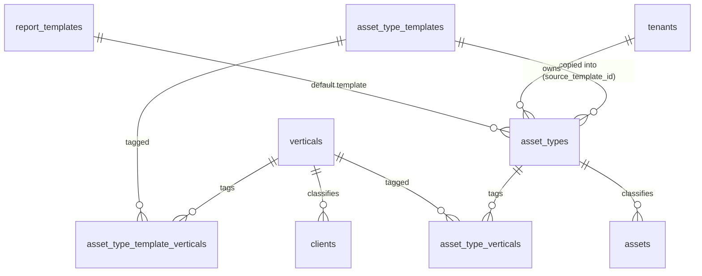

# A1 — Verticals and Asset Types: technical design

**Program:** Orbit Program A, slice A1  
**Status:** Draft for design review  
**Date:** 2026-10-22  
**Owner:** Tech Lead (Hisham)  
**Reviewers:** Solution Architect (Tariq), Backend Engineer, Frontend Engineer  
**Decision record:** [AgDR-A1-asset-type-copy-on-adopt.md](../AgDR-A1-asset-type-copy-on-adopt.md)  
**Cycle:** [A1_SPRINT_CYCLE.md](../cycles/A1_SPRINT_CYCLE.md)

---

## 1. Problem

Asset classification is a free-text string today.

| Fact | Location |
|------|----------|
| `Asset.category` is `String(64)`, default `"general"`. There is no catalog and no validation. | `backend/app/models/assets.py` |
| The register modal shows `category` as a free-text `<input>`. Users type "HVAC", "hvac", "Hvac " and get three categories. | `src/features/assets/components/AssetRegisterModal.tsx` |
| `GET /report-templates/asset-categories` builds the category list from `SELECT DISTINCT assets.category`. A category exists only after an asset uses it. | `backend/app/domains/reports/templates.py` |
| Report observation fields are keyed by category. The lookup is exact and case-sensitive (`key in by_cat`). | `backend/app/services/report_schema_resolve.py` `observation_fields_for_category` |
| The label code embeds a slug of the category (`SITE-HVAC-001`). | `backend/app/services/asset_labels.py` |
| `Client.activity_type` is a free-text `String(64)`. The UI offers 7 fixed values. The pilot seeds write `"commercial"`, which is not one of the 7 values. `ClientUpdate` cannot change it. | `models/clients.py`, `CompanyCreateModal.tsx`, `cli/pilot_seed.py`, `schemas/clients.py` |
| Lifecycle defaults (`max_age_years`, `max_repair_count`), criticality, and schedule frequency are typed per asset. Nothing derives them from the kind of equipment. | `AssetRegisterModal.tsx` (`maxAgeYears` defaults to `5` for every asset) |

**Consequences:** inconsistent categories, broken per-category report fields when the spelling differs, no sensible defaults per equipment kind, and no link between a client's industry (vertical) and the equipment that the industry uses.

## 2. Goals and non-goals

### Goals

1. A platform-owned **vertical** catalog (hospital, hotel, office, …) that replaces free-text `activity_type`.
2. A platform-owned **asset type catalog**. Each catalog entry is tagged with one or more verticals and carries default values.
3. A tenant-owned **asset type library**. A tenant adopts catalog entries by **copying** them (see the AgDR) and can add custom types.
4. `assets.asset_type_id` links each asset to a tenant asset type. The register modal picks a type, recommends types for the client's vertical, and pre-fills defaults.
5. Zero-downtime migration: expand, then backfill, then dual-write. The contract step happens in a later program.

### Non-goals (A1)

- Per-type custom attribute schemas (dynamic fields per type). This is reserved for a later slice. A1 adds no column for it.
- "Refresh from catalog" or a diff/merge UI for adopted types.
- Super-user CRUD UI for the platform catalog. In A1 the catalog is seed-only.
- Dropping `clients.activity_type` or making `assets.asset_type_id` NOT NULL (contract phase).
- Changing the label code format or reprinting labels.
- Changing report observation storage. It stays keyed by the category string.

## 3. Domain model



| Concept | Scope | Owner | Mutable by |
|---------|-------|-------|------------|
| Vertical | Platform (no `tenant_id`) | Platform | Seed only (A1) |
| Asset type template | Platform (no `tenant_id`) | Platform | Seed only (A1) |
| Asset type | Tenant | Maintenance company | `company_admin`, `super_admin` |
| Asset | Tenant | Maintenance company | Unchanged roles (`super_admin`, `company_admin`, `site_manager`) |

**Invariant I1:** `assets.category == asset_types.code` whenever `assets.asset_type_id` is set. All asset writes keep `category` as a denormalized mirror of the type code. Report observations, label codes, work-order context, and the existing `?category=` filter keep working without change.

**Invariant I2:** `asset_types.code` is immutable after the type is created. Renaming a code would orphan report observation keys and diverge from existing labels. Display names (`name_en`, `name_ar`) can change.

**Invariant I3:** A tenant has at most one asset type per `source_template_id`. Adoption is idempotent.

## 4. Data model

All new tables use the existing conventions: UUID primary keys via `_uuid`, `created_at` via `_utcnow`, `JSONB` for loose metadata. Postgres is the production database. SQLite (in-memory, `Base.metadata.create_all`) runs CI. The model must therefore avoid `ARRAY` and Postgres-only constraints. Join tables replace array columns for that reason.

New file: `backend/app/models/asset_types.py`. Export from `backend/app/models/__init__.py`.

### 4.1 `verticals` (platform)

| Column | Type | Notes |
|--------|------|-------|
| `id` | UUID PK | |
| `code` | `String(32)` NOT NULL, UNIQUE | `hospital`, `hotel`, `office`, `retail`, `industrial`, `education`, `other`. These match the current `activity_type` option values exactly. |
| `name_en` | `String(128)` NOT NULL | |
| `name_ar` | `String(128)` NOT NULL | |
| `sort_order` | `Integer` default 0 | |
| `is_active` | `Boolean` default true | |
| `created_at` | timestamptz | |

### 4.2 `asset_type_templates` (platform catalog)

| Column | Type | Notes |
|--------|------|-------|
| `id` | UUID PK | |
| `code` | `String(64)` NOT NULL, UNIQUE | Stable slug, for example `hvac_chiller`. |
| `name_en`, `name_ar` | `String(128)` NOT NULL | |
| `default_max_age_years` | `Integer` NULL | |
| `default_max_repair_count` | `Integer` NULL | |
| `default_criticality` | `String(32)` NULL | `low`/`medium`/`high`/`critical`. These match `AssetCriticality`. |
| `default_frequency` | `String(32)` NULL | One of the `FREQUENCY_DAYS` keys in `services/maintenance_schedules.py`. |
| `default_report_template_code` | `String(64)` NULL | Resolved against the tenant's `report_templates.code` during adoption (for example `STD-INSP`). |
| `version` | `Integer` default 1 | Incremented when the seed changes the entry. Copied into the tenant row as `source_version`. |
| `is_active` | `Boolean` default true | |
| `created_at`, `updated_at` | timestamptz | |

### 4.3 `asset_type_template_verticals` (join)

`template_id` FK → `asset_type_templates.id`, `vertical_id` FK → `verticals.id`, and a composite PK. A template with no rows is "universal". It is recommended for every vertical.

### 4.4 `asset_types` (tenant library)

| Column | Type | Notes |
|--------|------|-------|
| `id` | UUID PK | |
| `tenant_id` | UUID FK `tenants.id` NOT NULL | |
| `code` | `String(64)` NOT NULL | Equals `assets.category` for linked assets (I1). Immutable (I2). |
| `name_en`, `name_ar` | `String(128)` NOT NULL | |
| `default_max_age_years`, `default_max_repair_count` | `Integer` NULL | Copied from the template, then tenant-editable. |
| `default_criticality`, `default_frequency` | `String(32)` NULL | Copied, then editable. |
| `default_report_template_id` | UUID FK `report_templates.id` NULL | Resolved from `default_report_template_code` during adoption. The service must check that it belongs to the same tenant. |
| `origin` | `String(16)` NOT NULL | `catalog` (adopted), `custom` (created by the tenant), `legacy` (created by the backfill from an existing category string). |
| `source_template_id` | UUID FK `asset_type_templates.id` NULL | Provenance only. No live reads (see AgDR). |
| `source_version` | `Integer` NULL | Template `version` at copy time. |
| `adopted_at` | timestamptz NULL | |
| `is_active` | `Boolean` default true | Archive flag. Archived types are hidden from the picker and remain valid on existing assets. |
| `created_at`, `updated_at` | timestamptz | |

Constraints:

- `UniqueConstraint("tenant_id", "code", name="uq_asset_type_tenant_code")`. This constraint is case-sensitive in the database. The service additionally rejects a new code that equals an existing code case-insensitively (`ASSET_TYPE_CODE_CONFLICT`). The service does not rewrite legacy rows that already differ only by case (see §8, risk R2).
- `UniqueConstraint("tenant_id", "source_template_id", name="uq_asset_type_tenant_source")`. Both Postgres and SQLite treat NULLs as distinct, so custom and legacy rows do not collide (I3).
- Index `ix_asset_types_tenant_active (tenant_id, is_active)`.

### 4.5 `asset_type_verticals` (join, tenant)

`asset_type_id` FK → `asset_types.id` (ON DELETE CASCADE), `vertical_id` FK → `verticals.id`, composite PK. Copied from the template's vertical tags during adoption. The tenant can edit the tags.

### 4.6 Changes to existing tables

| Table | Change | Phase |
|-------|--------|-------|
| `clients` | Add `vertical_id` UUID FK `verticals.id` NULL. Keep `activity_type` (dual-write). | Expand |
| `assets` | Add `asset_type_id` UUID FK `asset_types.id` NULL. Add index `ix_assets_tenant_asset_type (tenant_id, asset_type_id)`. Keep `category` (I1). | Expand |

ORM relationships: `Asset.asset_type` (many-to-one, lazy `joined` only where the router asks for it), `Client.vertical`, `AssetType.verticals` (secondary `asset_type_verticals`), `AssetTypeTemplate.verticals`.

### 4.7 Seed catalog (initial content)

A new service `backend/app/services/asset_type_catalog.py` holds the seed as a Python constant and exposes `ensure_vertical_catalog(db) -> dict[str, int]`. The function upserts by `code` and is idempotent. It follows the `ensure_default_packages` pattern in `services/platform_bootstrap.py`. It runs from `run_wave0_platform_bootstrap`, which `docker_migrate` already calls after `alembic upgrade head`.

Verticals: `hospital` (مستشفى), `hotel` (فندق), `office` (مكاتب), `retail` (تجزئة), `industrial` (صناعي), `education` (تعليمي), `other` (أخرى).

| Template code | EN | AR | Verticals | Max age (y) | Freq | Criticality |
|---------------|----|----|-----------|-------------|------|-------------|
| `hvac_ahu` | Air handling unit | وحدة مناولة الهواء | universal | 15 | quarterly | high |
| `hvac_chiller` | Chiller | مبرد مياه (تشيلر) | hospital, hotel, office, retail, industrial, education | 20 | quarterly | critical |
| `hvac_split` | Split AC unit | مكيف سبليت | universal | 10 | quarterly | medium |
| `elevator` | Elevator | مصعد | hospital, hotel, office, retail, education | 25 | monthly | critical |
| `escalator` | Escalator | سلم كهربائي | retail, hotel | 25 | monthly | high |
| `fire_alarm_panel` | Fire alarm panel | لوحة إنذار الحريق | universal | 15 | quarterly | critical |
| `fire_pump` | Fire pump | مضخة حريق | universal | 20 | monthly | critical |
| `generator` | Standby generator | مولد احتياطي | hospital, hotel, office, industrial | 25 | monthly | critical |
| `electrical_panel` | Electrical panel | لوحة كهربائية | universal | 30 | yearly | high |
| `ups` | UPS | مزود طاقة غير منقطعة (UPS) | hospital, office, industrial | 10 | quarterly | high |
| `water_pump` | Water pump | مضخة مياه | universal | 15 | quarterly | medium |
| `lighting_system` | Lighting system | نظام الإنارة | universal | 10 | yearly | low |
| `automatic_door` | Automatic door | باب أوتوماتيكي | hospital, retail, office | 12 | quarterly | medium |
| `bms_controller` | BMS controller | وحدة تحكم نظام إدارة المباني | hospital, hotel, office | 12 | yearly | medium |
| `medical_gas` | Medical gas system | نظام الغازات الطبية | hospital | 20 | quarterly | critical |
| `nurse_call` | Nurse call system | نظام استدعاء التمريض | hospital | 12 | quarterly | high |
| `sterilizer` | Sterilizer (autoclave) | جهاز تعقيم (أوتوكلاف) | hospital | 15 | monthly | critical |
| `kitchen_hood` | Kitchen exhaust hood | شفاط المطبخ | hotel, hospital | 15 | quarterly | medium |
| `laundry_equipment` | Laundry equipment | معدات المغسلة | hotel, hospital | 12 | quarterly | medium |
| `pool_pump` | Pool pump | مضخة المسبح | hotel | 10 | monthly | medium |
| `cold_room` | Cold room | غرفة تبريد | retail, hotel, hospital | 15 | monthly | high |
| `air_compressor` | Air compressor | ضاغط هواء | industrial | 15 | quarterly | high |
| `conveyor` | Conveyor | سير ناقل | industrial | 15 | monthly | high |

`default_report_template_code` is `STD-INSP` for all entries in A1. Product must sign off on the values above before merge (open question Q2).

## 5. API

All routes live under `/api/v1`. Error `detail` values follow the existing upper-snake convention (`INVALID_LOCATION`, `ASSET_RETIRED`). Tenant isolation follows the existing pattern: every query filters on `current.tenant_id`, and a cross-tenant ID returns `404 NOT_FOUND`.

New router: `backend/app/domains/assets/asset_types.py` (`prefix="/asset-types"`). Register it beside the assets router. Guard it with `require_feature("assets")`.  
New router: `backend/app/domains/platform/verticals.py` for `/verticals` and `/asset-type-catalog`.

### 5.1 Endpoints

| Method | Path | Roles | Purpose |
|--------|------|-------|---------|
| GET | `/verticals` | any authenticated | List active verticals: `[{id, code, name_en, name_ar}]` ordered by `sort_order`. |
| GET | `/asset-type-catalog?vertical=<code>` | `company_admin`, `super_admin`, `super_user` | List active templates. With `vertical`, the result contains templates tagged with that vertical plus universal templates. Each item includes `adopted: bool` and `asset_type_id` for the caller's tenant. |
| POST | `/asset-types/adopt` | `company_admin`, `super_admin` | Body `{template_ids: UUID[]}` (1–100). Copies each template into the tenant library. Response: `{created: AssetTypeOut[], skipped: [{template_id, asset_type_id, reason}]}`. `reason` is `already_adopted` or `merged_with_existing_code`. |
| GET | `/asset-types?client_id=&vertical=&include_inactive=false` | any authenticated tenant user | The tenant library. If `client_id` or `vertical` is given, each item has `recommended: bool`, and recommended items sort first, then by localized name. `client_id` is subject to client scope (a `client_admin` can pass only their own client). |
| POST | `/asset-types` | `company_admin`, `super_admin` | Create a custom type (`origin=custom`). Body: `code`, `name_en`, `name_ar`, optional defaults, `vertical_codes[]`. |
| PATCH | `/asset-types/{id}` | `company_admin`, `super_admin` | Edit names, defaults, vertical tags, and `is_active`. `code` in the body returns `400 ASSET_TYPE_CODE_IMMUTABLE`. |
| GET | `/asset-types/{id}` | any authenticated tenant user | A single type, with `asset_count`. |

The API has no DELETE. Archive (`is_active=false`) is the only removal path. A type that is still referenced stays valid on its assets.

### 5.2 Schemas (`backend/app/schemas/asset_types.py`)

```python
class VerticalOut(BaseModel):
    id: UUID; code: str; name_en: str; name_ar: str

class AssetTypeTemplateOut(BaseModel):
    id: UUID; code: str; name_en: str; name_ar: str
    vertical_codes: list[str]
    default_max_age_years: int | None; default_max_repair_count: int | None
    default_criticality: str | None; default_frequency: str | None
    version: int
    adopted: bool = False; asset_type_id: UUID | None = None

class AssetTypeOut(BaseModel):
    id: UUID; code: str; name_en: str; name_ar: str
    origin: Literal["catalog", "custom", "legacy"]
    vertical_codes: list[str]
    default_max_age_years: int | None; default_max_repair_count: int | None
    default_criticality: str | None; default_frequency: str | None
    default_report_template_id: UUID | None
    source_template_id: UUID | None; source_version: int | None
    is_active: bool
    recommended: bool = False

class AssetTypeCreate(BaseModel):
    code: str = Field(..., min_length=1, max_length=64, pattern=r"^[A-Za-z0-9][A-Za-z0-9 _\-]*$")
    name_en: str = Field(..., min_length=1, max_length=128)
    name_ar: str = Field(..., min_length=1, max_length=128)
    vertical_codes: list[str] = Field(default_factory=list)
    default_max_age_years: int | None = Field(None, ge=1, le=100)
    default_max_repair_count: int | None = Field(None, ge=0, le=1000)
    default_criticality: AssetCriticality | None = None
    default_frequency: Literal["daily", "weekly", "monthly", "quarterly", "yearly"] | None = None
    default_report_template_id: UUID | None = None

class AssetTypeUpdate(BaseModel):  # every field optional; no `code`
    ...

class AssetTypeAdoptRequest(BaseModel):
    template_ids: list[UUID] = Field(..., min_length=1, max_length=100)
```

The `code` pattern allows spaces and mixed case. Legacy categories such as `Fire Safety` must be representable (I1).

### 5.3 Changes to existing endpoints

**`POST /assets`** (`AssetCreate`):

- Add `asset_type_id: Optional[UUID] = None`.
- Resolution order in `create_asset`:
  1. If `asset_type_id` is set, load it. If it is missing or belongs to another tenant, return `400 INVALID_ASSET_TYPE`. If it is archived, return `400 ASSET_TYPE_ARCHIVED`. If the body also sends a non-default `category` that differs from `type.code`, return `400 ASSET_TYPE_CATEGORY_MISMATCH`. Set `category = type.code`.
  2. If `asset_type_id` is not set (legacy clients and CSV import), look up the tenant type with `code == category` (exact match). If it exists, link it. If it does not, leave `asset_type_id` NULL. The nightly or on-demand backfill links it later. The endpoint does **not** auto-create types on write. This prevents typo types.
- Defaults: for each of `max_age_years`, `max_repair_count`, `criticality`, if the body value is `None` and the type has a default, apply the type default. Explicit body values always win.
- The label code is unchanged. It is still generated from `category`, which now equals `type.code`.
- Schedule: unchanged. The server does **not** create a schedule from the type defaults. The client pre-fills the schedule section and sends `schedule` explicitly. This keeps schedule creation visible to the user.

**`PATCH /assets/{id}`** (`AssetUpdate`):

- Add `asset_type_id: Optional[UUID]`. Changing the type sets `category = type.code` and writes an audit entry with before and after values (`asset_type_id`, `category`). `label_code` is **not** regenerated, because it identifies a physical sticker.
- Sending `category` alone on an asset that has an `asset_type_id` returns `400 ASSET_TYPE_CATEGORY_MISMATCH`, unless `category` equals the current type code. This protects I1.

**`AssetOut`**: add `asset_type_id: Optional[UUID]` and `asset_type: Optional[AssetTypeRef]` (`{id, code, name_en, name_ar}`). `list_assets` and `get_asset` add `joinedload(Asset.asset_type)` to avoid N+1 queries.

**`GET /assets`**: add the query parameter `asset_type_id`. Keep `category`.

**`GET /report-templates/asset-categories`**: return the union of active `asset_types.code` and `DISTINCT assets.category`, de-duplicated and sorted. The response shape (`list[str]`) does not change, so `CategoryObservationsEditor` keeps working. A newly adopted type then appears before any asset uses it.

**CSV import** (`services/asset_import.py`): keep the `category` column. Apply the same resolution as step 2 above. Add an optional `asset_type_code` column. If it is present and unknown, the preview row gets the error `unknown asset type`.

**Clients** (`schemas/clients.py`, `domains/clients/router.py`, `domains/platform/router.py`):

- `ClientCreate`, `ClientProvisionRequest`: add `vertical_code: Optional[str]`. Keep `activity_type`. If only `activity_type` is sent, resolve it via the alias map (§6.3). If both are sent and they disagree, `vertical_code` wins. Persist both `vertical_id` and `activity_type = vertical.code` (dual-write).
- `ClientUpdate`: add `vertical_code: Optional[str]`. Today there is no way to change a client's activity type after creation.
- `ClientOut`: add `vertical_code: Optional[str]`. Keep `activity_type`.
- Unknown `vertical_code` returns `400 INVALID_VERTICAL`.

### 5.4 Adoption algorithm (`services/asset_types.py::adopt_templates`)

```
for template_id in dedupe(template_ids):
    tmpl = active template, else 400 INVALID_TEMPLATE (whole request rolls back)
    if tenant has asset_type with source_template_id == tmpl.id:
        skipped += (already_adopted)
        continue
    existing = tenant asset_type where lower(code) == lower(tmpl.code)
    if existing:                          # legacy or custom row with the same code
        existing.source_template_id = tmpl.id
        existing.source_version = tmpl.version
        existing.adopted_at = now
        fill only the NULL defaults on existing from tmpl   # never overwrite tenant values
        skipped += (merged_with_existing_code)
        continue
    create asset_type copying code, names, defaults, origin=catalog,
        source_template_id, source_version, adopted_at
    copy the vertical tags
    resolve default_report_template_id = tenant report_templates where code == tmpl.default_report_template_code
write_audit(action="adopt_asset_types", entity_type="asset_type", after={created, skipped})
single commit
```

Legacy codes such as `HVAC` do not collide with catalog codes such as `hvac_ahu`. The merge branch triggers only on an exact case-insensitive code match. A1 provides no automatic semantic mapping between a legacy category such as `HVAC` and a catalog entry such as `hvac_ahu` (see risk R3).

## 6. Migration plan (expand → backfill → dual-write → contract)

Per [AgDR-SCHEMA-ENSURE](../../decisions/AgDR-SCHEMA-ENSURE.md), all schema changes go through **Alembic**. `schema_ensure.py` is **not** modified. Current head: `extend_user_role_enum`.

### 6.1 Phase E — expand (migration `c4d5e6f7a8b9_a1_verticals_asset_types.py`)

- `down_revision = "extend_user_role_enum"`.
- Create `verticals`, `asset_type_templates`, `asset_type_template_verticals`, `asset_types`, `asset_type_verticals`.
- `op.add_column("clients", vertical_id NULL)` and `op.add_column("assets", asset_type_id NULL)`. Add FKs and indexes.
- Use the inspector guard style of `a1b2c3d4e5f6_add_client_activity_type.py` (`if col not in cols`). This keeps the migration safe on old demo volumes.
- All columns are nullable and have no server default, so Postgres does not rewrite the table. On Postgres, create the index on `assets` with `postgresql_concurrently=True` inside `op.get_context().autocommit_block()`. Skip that path on other dialects.
- `downgrade()` drops the FKs and indexes, the two columns, and the five tables, in reverse order.
- The migration contains **no data**. The catalog seed and the backfill are separate steps, so the migration stays fast and reversible.

**Ticket gate:** this needs a `/migration` ticket and a migration AgDR entry, according to the ApexYard migration gate. The AgDR in this design covers the copy-vs-reference decision only.

### 6.2 Phase S — seed catalog

`ensure_vertical_catalog(db)` runs in `run_wave0_platform_bootstrap`. It upserts by `code`. If a seed entry's fields differ from the stored row, it updates the row and increments `version`. It never deletes rows; entries removed from the seed get `is_active=false`. This step is idempotent.

### 6.3 Phase B — backfill (`python -m app.cli.backfill_asset_types [--tenant <uuid>] [--dry-run]`)

The backfill runs per tenant, in one transaction per tenant, and is safe to re-run.

1. **Clients:** for each client with `vertical_id IS NULL AND activity_type IS NOT NULL`, map `lower(trim(activity_type))` through the alias map and set `vertical_id`.
   - Identity: `hospital`, `hotel`, `office`, `retail`, `industrial`, `education`, `other`.
   - Aliases: `commercial → office` (pilot seed value; open question Q1), `healthcare`/`clinic → hospital`, `school`/`university → education`, `factory`/`warehouse → industrial`, `mall`/`shop → retail`.
   - Unmapped values → `other`. The original string stays in `activity_type` and the CLI prints it in the report.
2. **Asset types:** for each `DISTINCT category` in the tenant's `assets` (including `general`), create an `asset_types` row with `origin=legacy`, `code=category` verbatim, `name_en=name_ar=category`, and all defaults NULL, unless a row with that exact code already exists.
3. **Assets:** `UPDATE assets SET asset_type_id = t.id FROM asset_types t WHERE t.tenant_id = assets.tenant_id AND t.code = assets.category AND assets.asset_type_id IS NULL`. Run it in batches of 1,000 rows on Postgres.
4. Output a JSON report: clients mapped and unmapped, legacy types created, assets linked, assets still unlinked (target 0), and case-variant groups (for example `HVAC`/`hvac`) for manual cleanup.

`docker_migrate` runs the backfill after the bootstrap step. The step is gated by the environment variable `A1_BACKFILL=1`, so a production run is an explicit operator action.

### 6.4 Phase D — dual-write (A1 release onward)

- Asset writes always set both `asset_type_id` (when resolvable) and `category` (I1).
- Client writes always set both `vertical_id` and `activity_type`.
- Readers prefer the new columns and fall back to the old ones. The frontend shows `asset_type.name_*` when it is present, and `category` otherwise.

### 6.5 Phase C — contract (out of A1 scope; separate migration ticket)

Preconditions: the backfill report shows 0 unlinked assets in every environment for 2 consecutive weekly runs, and no write path still sends a bare `category`.

Then: make `assets.asset_type_id` NOT NULL, drop `clients.activity_type`, and make `category` a read-only property (or a DB-generated value) that mirrors the type code.

### 6.6 Rollback

| Point | Action |
|-------|--------|
| After E, before B | `alembic downgrade -1`. No data loss, because the new columns are empty. |
| After B | Revert the application release only. The old code ignores the new nullable columns. The legacy `category` and `activity_type` values remain correct, because dual-write never stopped writing them. Do not downgrade the schema. That would drop the tenants' adopted and custom types. |

## 7. Frontend changes

### 7.1 Types and API helpers

- `src/shared/lib/types.ts`: add `Vertical`, `AssetType`, `AssetTypeTemplate`, and `AssetTypeRef`. Extend the asset row types (`AssetsPage`, `AssetDetailPage`, `SiteDetailPage` each declare a local `category: string`; add `asset_type?: AssetTypeRef | null`).
- `src/shared/lib/assetTypeLabel.ts` (new): `assetTypeLabel(row, lang)` returns `name_ar` or `name_en` for the active language and falls back to `category`. Use it on every surface that currently renders `category`.

### 7.2 `AssetRegisterModal.tsx`

- Replace the free-text **Category** `<input>` with an **Asset type** picker.
  - Load `GET /asset-types?client_id=<clientId>` when the effective client changes. This follows the same effect pattern that reloads sites today.
  - Render `<optgroup>` "Recommended for {vertical}" (`recommended=true`), then "All types". With 0 recommended types, render a flat list.
  - Show the label in the active language. RTL works through the existing `dir` handling.
  - Include an empty state for a tenant with no types. Admins see a link to the asset type library ("Adopt types from catalog"). Other roles see an explanatory hint.
- On type change, pre-fill the fields **only if the user has not edited them** (track a `touched` set):
  - `maxAgeYears` ← `default_max_age_years` (replaces the hard-coded `5`).
  - `criticality` ← `default_criticality`.
  - `frequency` ← `default_frequency`; `templateId` ← `default_report_template_id`. If both exist, also enable `scheduleEnabled`. The user can still turn it off.
- Submit `asset_type_id`. Stop sending `category`; the server derives it.
- Validation: the type is required when the tenant has at least one active type. Otherwise (a pre-backfill tenant) fall back to the old free-text field. This avoids blocking registration during rollout.
- Reset the type and touched state in the post-submit reset block that already exists.

### 7.3 Other screens

| File | Change |
|------|--------|
| `AssetEditModal.tsx` | Same picker. Show the warning "Changing type does not change the printed label code". |
| `AssetsPage.tsx`, `FilterBar.tsx` | The category filter becomes an asset type filter (`asset_type_id`). Keep reading `?category=` from old URLs. |
| `AssetDetailPage.tsx`, `SiteDetailPage.tsx`, work-order pages | Render via `assetTypeLabel`. |
| `CompanyCreateModal.tsx` | Load the options from `GET /verticals` instead of the hard-coded `<option>` list. Send `vertical_code`. Keep the i18n fallback keys `activity_*` until contract. |
| `CompanyEditModal.tsx` | Add the vertical select (new capability). |
| New `src/features/assets/pages/AssetTypesPage.tsx` | Admin library: list the tenant types (origin badge, vertical chips, asset count, archive toggle), a "Browse catalog" drawer with a vertical filter, multi-select, and **Adopt**, plus a "New custom type" form. Route `/asset-types`, guarded by `FeatureRoute` `assets` and roles `company_admin`/`super_admin`. Add a nav entry in `navItems.ts` under Assets. |
| `src/i18n/locales/{en,ar}.json` | New keys: `asset_type`, `asset_types`, `select_asset_type`, `recommended_for_vertical`, `all_asset_types`, `adopt_from_catalog`, `adopt_selected`, `already_adopted`, `custom_type`, `legacy_type`, `archive_type`, `no_asset_types_admin`, `no_asset_types_user`, `vertical`, `select_vertical`, `type_change_label_warning`, and the `origin_*` keys. |

Mobile-first: the picker is a native `<select>`, which gives a usable picker on phones. The `AssetTypesPage` catalog drawer is a full-screen sheet below `lg`. This follows [MOBILE_FIRST_CYCLE.md](../MOBILE_FIRST_CYCLE.md).

## 8. Risks and mitigations

| ID | Risk | Likelihood | Impact | Mitigation |
|----|------|-----------|--------|------------|
| R1 | Breaking report observations by changing `asset.category` values | Medium | High | I1 and I2. `category` always equals the type code, and the code is immutable. The backfill uses the category verbatim. Unit test: an observation lookup returns the same fields before and after the backfill. |
| R2 | Legacy case variants (`HVAC` vs `hvac`) become two legacy types | High | Low | The backfill reports the variant groups. A merge tool is a follow-up (re-points assets and re-keys observations). A1 does not auto-merge, because merging changes the observation keys. |
| R3 | Tenants end up with both a legacy `HVAC` and an adopted `hvac_ahu` | High | Medium | The library page shows the origin badge. Follow-up "map legacy type → catalog type" action. Document this for pilot operators. |
| R4 | Catalog drifts from adopted copies (catalog fixes do not reach tenants) | Certain | Low | Accepted by the AgDR. `source_version` makes the drift detectable. "Refresh from catalog" is a later slice. |
| R5 | `activity_type` values outside the alias map (`commercial`) | Known | Low | Alias map, `other` fallback, CLI report. Open question Q1. |
| R6 | SQLite CI vs Postgres prod behaviour (case-insensitive lookups, concurrent index) | Medium | Medium | Compare codes with `func.lower()` in the service, never through DB collation. Dialect-guard the concurrent index. Add a Postgres job for the migration test if CI gains a PG service. Until then, run a manual `alembic upgrade head` / `downgrade -1` on a pilot dump before merge. |
| R7 | N+1 queries on the asset list after the join is added | Medium | Medium | `joinedload(Asset.asset_type)`. Test that asserts the query count for list_assets with 50 assets. |
| R8 | Archived type is still chosen through a stale UI | Low | Low | The server rejects it with `ASSET_TYPE_ARCHIVED`. |
| R9 | `default_report_template_id` points at another tenant's template | Low | High | Validate the tenant on create, patch, and adopt. Test it in `test_isolation`. |
| R10 | Registration is blocked for tenants before the backfill | Medium | High | Free-text fallback when the tenant has 0 active types (§7.2). Run the backfill in the same release window. |

## 9. Open questions

| ID | Question | Owner | Default if unanswered |
|----|----------|-------|-----------------------|
| Q1 | Should `commercial` be its own vertical or map to `office`? | Product | Map to `office`. |
| Q2 | Sign-off on the seed catalog values (§4.7): lifetimes, frequencies, criticality | Product + domain SME | Ship as written. Values are tenant-editable after adoption. |
| Q3 | Should a new tenant auto-adopt the universal templates at provisioning? | Product | No. Explicit adoption only in A1. |
| Q4 | Can `site_manager` create custom types? | Product | No. Admin roles only. |

## 10. Rollout

1. PR 1 (BE): models, migration, catalog seed, `/verticals`, `/asset-type-catalog`, `/asset-types`, and the asset and client endpoint changes. Feature-safe, because the new fields are optional.
2. PR 2 (BE): backfill CLI and `docker_migrate` wiring.
3. PR 3 (FE): register and edit modals, company modals, `AssetTypesPage`, i18n.
4. PR 4 (tests): Playwright e2e for adopt → register → report observations.
5. Pilot: run the backfill with `--dry-run`, review the report, then run it for real. Then run the e2e suite against pilot.

## 11. References

- `backend/app/models/assets.py`, `backend/app/models/clients.py`, `backend/app/models/templates.py`
- `backend/app/domains/assets/router.py`, `backend/app/schemas/assets.py`, `backend/app/schemas/clients.py`
- `backend/app/services/asset_labels.py`, `asset_metadata.py`, `asset_import.py`, `maintenance_schedules.py`, `report_schema_resolve.py`, `platform_bootstrap.py`
- `backend/migrations/versions/a1b2c3d4e5f6_add_client_activity_type.py`, `extend_user_role_enum.py`
- `src/features/assets/components/AssetRegisterModal.tsx`, `src/features/companies/components/CompanyCreateModal.tsx`
- [AgDR-SCHEMA-ENSURE](../../decisions/AgDR-SCHEMA-ENSURE.md)
