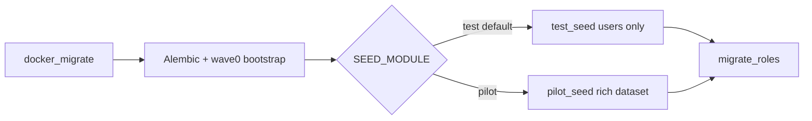

# Docker seed profiles

How `docker_migrate` chooses seed data for local development vs the **pilot** stack.

**Related:** [local-development.md](./local-development.md) · [environments.md](./environments.md) · `/docker-debug` skill

---

## Architecture

| Profile | Compose project | Database | Web | API | DB host | `SEED_MODULE` | Dataset |
|---------|-----------------|----------|-----|-----|---------|---------------|---------|
| **Local DEV** | `fms-local` | `fms_local` | **9080** / Vite **5173** | **9000** / host **8000** | **9432** | `test` | Users only |
| **Pilot** | `fms-pilot` | `fms_pilot` | **9081** | **9001** | **9543** | `pilot` (legacy alias `pitch`) | Rich pilot dataset (~50 WOs) |

Compose `name:` keeps stacks separate. Pilot DB is **9543** (not 5433 — native Windows Postgres often owns 5433). Ports **9001/9081** avoid reserved **8001–8100**.

Entry point: `python -m app.docker_migrate` (migrate service in compose).

Pilot reset (`POST /api/v1/platform/pilot/reset`; the legacy path `/platform/demo/reset` still works) re-runs `pilot_seed` when `APP_ENV=pilot`. It produces the same dataset as migrate.

---

## Local DEV seed (`test_seed`)

**Purpose:** Give developers login accounts for every role without pre-populating companies, assets, or work orders. UI flows start from an empty tenant.

**Accounts (password = `{local_part}{SEED_PASSWORD_SUFFIX}`, default suffix `123`; legacy `DEMO_PASSWORD_SUFFIX` still read):**

| Email | Role |
|-------|------|
| super@demo.com | super_user (platform) |
| swdev@demo.com | sw_dev (platform) |
| admin@demo.com | company_admin |
| engineer@demo.com | company_engineer |
| manager@demo.com | manager |
| client@demo.com | client_admin |
| site@demo.com | site_manager |
| tech@demo.com | technician |

**Idempotency:** Truncates tenant-scoped tables, then inserts one tenant + users. Safe to re-run via `docker compose ... up migrate --build`.

---

## Pilot seed (`pilot_seed`)

**Purpose:** Sales, UAT, and E2E — dashboards and lists look active on first load.

**Includes:**

- 2 clients (Global Enterprises, Riyadh Retail) with sites and billing contracts
- ~12–15 assets across HVAC, elevators, electrical, plumbing, fire safety
- 7 seed users with client/site scope wiring
- ~50 work orders distributed across lifecycle statuses (`created`, `assigned`, `in_progress`, `on_hold`, `completed`, `verified`, `closed`, `cancelled`, …)
- Standard inspection report template; optional draft invoices on verified WOs

**Seed logins:** see [pilot-stack.md](./pilot-stack.md#seed-accounts).

---

## Shared utilities

[`backend/app/cli/_seed_lib.py`](../../backend/app/cli/_seed_lib.py):

- `truncate_tenant_data(db)` — FK-safe wipe before insert (PostgreSQL `TRUNCATE CASCADE`; SQLite ordered deletes in tests)
- `create_seed_user(db, tenant_id, spec)` — consistent user field population

---

## Troubleshooting

| Symptom | Check |
|---------|--------|
| `password authentication failed` on 5433 | Wrong Postgres (native Windows). Use **9432** (dev) or **9543** (pilot) |
| Compose stacks overwrite each other | Files must have `name: fms-local` / `name: fms-pilot` |
| Port bind 8001/8081 | Windows reserved range; use **9001** / **9081** |
| Wrong data shape | `SEED_MODULE`; rebuild migrate after seed changes |
| `relation does not exist` | Seed before Alembic — use `app.docker_migrate` |
| Re-seed without wiping volume | Seeds truncate tenant data; or `docker compose down -v` |

Full compose debugging: `.claude/skills/docker-debug/SKILL.md`.
