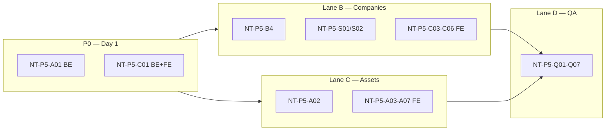

# Wave 5 — UAT Findings (Companies + Assets)

**Captured:** 2026-06-06  
**Tester persona:** Maintenance company admin  
**Branch:** `feature/phase-3-restructure/wave3`  
**Tech Lead:** Hisham — task breakdown + parallel lanes  
**Prior docs:** [01_wave3_uat_observations.md](./01_wave3_uat_observations.md), [03_wave4_mega_prompt.md](./03_wave4_mega_prompt.md)

---

## How to use this doc

| Column | Meaning |
|--------|---------|
| **ID** | Stable task reference (`NT-P5-*`) for tickets and agent handoff |
| **Root cause** | Verified in code (not speculation) |
| **Owner** | Primary implementer lane |
| **Status** | `Open` → `In progress` → `Fixed` → `Verified` |

**Rule:** Agents implement against task IDs here. Do not re-interpret from chat screenshots alone.

---

## Executive summary

Wave 5 feedback clusters into **two domains** with one **P0 backend gap** that blocks multiple UI fixes:

| Domain | Findings | P0 blockers |
|--------|----------|-------------|
| **Companies** | Triple site on create; wrong list aggregates; archived hidden; site Edit/QR stubs; manager assignment UX | Duplicate `Site` insert in `clients.py` + redundant POST in `CompanyCreateModal` |
| **Assets** | Calendar needs monthly view; WO panel/detail shows **all company WOs**; table missing warranty/EOL; lifecycle not editable; retire semantics; spare-device flag; detail header UX | **`GET /work-orders` ignores `asset_id` query param** |

OBS-AST-07 was marked Fixed in Wave 3 but **regressed / never wired on backend** — treat NT-P5-A01 as reopen.

---

## Architect decisions (binding)

### B1 — Retire asset = out of service / EOL

| Action | Backend | UI |
|--------|---------|-----|
| **Retire** | Sets `lifecycle_status = replaced` (existing) | Label as “Retired / Out of service”; hide retire when already `replaced` |
| **Manual EOL** | Admin may PATCH `lifecycle_status` to `end_of_life` without retire | Edit modal dropdown |
| **Warning** | Computed or manual `warning` | Editable in edit modal; auto-compute remains future enhancement |

Retire is **destructive** (blocks further edits). Manual lifecycle edit is for ops correction only.

### B2 — Spare device flag

Store on asset as **`metadata_json.is_spare: boolean`** (default `false`).

- Exposed on `AssetOut`, `AssetCreate`, `AssetUpdate` via `asset_metadata.py` helpers (same pattern as `floor`, `criticality`).
- Register + Edit modals: checkbox “Spare device (swap-out maintenance)”.
- No WO workflow change in Wave 5 — flag is data capture only; swap-out WO flow is a follow-up.

### B3 — Site manager assignment model

| Flow | When | Endpoint |
|------|------|----------|
| **Company provision** | Create company + **one** site + **company admin** (client_admin) | `POST /clients/provision` — site fields optional future; v1 keeps one site |
| **Add site** | Site only, no manager | `POST /sites` (add-only modal) |
| **Assign / change manager** | **Existing** site | New: `PATCH /sites/{id}` + `POST /sites/{id}/assign-manager` OR extend provision to existing site only |

Company create must **not** create a site manager — only company admin. Site managers are assigned per site afterward.

### B4 — Companies list aggregates

Extend `GET /clients` response (or add `GET /clients/summary`) with per-row:

- `sites_count` — count active sites for client
- `active_wo_count` — WOs in `{requested, created, assigned, in_progress, on_hold}`
- `primary_contact_email` / `primary_contact_phone` — from company admin user (`client_admin` role, `client_id` match); fallback `billing_email`

### B5 — Maintenance calendar views

| View | Buckets | Backend `view` param |
|------|---------|----------------------|
| Monthly | 1–12 (single month grid or 12-column year) | `monthly` |
| Quarterly | Q1–Q4 | `quarterly` (existing) |
| Yearly | 12 months at year granularity | `yearly` (existing — rename UI label if needed) |

**Note:** Current UI “Yearly” already buckets by month. New **Monthly** view = pick one month, show day-level or week-level events (minimum: filter events to selected month in a 1-bucket or calendar grid).

### B6 — Asset detail header

- **Title:** `{asset.name}` only (no label code in H1).
- **Subtitle:** `{company_name} • {site_name} • {category}`.
- **Breadcrumb:** Assets › {asset.name}.
- Enrich `GET /assets/{id}` with `company_name`, `site_name` (join site → client) — avoid N+1 on detail page.

### B7 — Maintenance history tab filter

Show WOs where:

1. `asset_id` matches (requires B1 / NT-P5-A01), **and**
2. Status in `{completed, verified, closed}`, **and**
3. Prefer `work_type` / tags containing `maintenance` OR schedule-linked WOs — if no `work_type` field, filter by title/tag heuristic or `category=maintenance` if present; document chosen rule in PR.

---

## Root cause analysis (verified)

### RC-1 — Three sites on company create

**Cause:** Triple site creation.

1. `backend/app/api/routes/clients.py` lines 113–120 **and** 129–138 — two `Site(...)` blocks in one transaction.
2. `src/components/CompanyCreateModal.tsx` lines 91–100 — after provision, **also** `POST /sites` with same name.

**Fix:** Remove duplicate block in `clients.py`; remove redundant `POST /sites` in modal (keep single site in provision).

### RC-2 — Asset WO panel shows all company work orders

**Cause:** Frontend passes `?asset_id=` but backend `list_work_orders` has **no `asset_id` parameter** (`work_orders.py` ~261–336).

**Fix:** Add `asset_id: UUID | None = Query(None)` and `q = q.where(WorkOrder.asset_id == asset_id)`.

### RC-3 — Companies list empty contact / zero sites / zero WOs

**Cause:** `CompaniesPage` maps only `ClientOut` fields; API returns no `sites_count`, `active_wo_count`, or admin contact. `contact_email` uses `billing_email` (often null).

**Fix:** B4 backend enrichment + frontend mapping.

### RC-4 — Archived companies not visible

**Cause:** `GET /clients` defaults `include_archived=false`; UI never passes `include_archived=true` or toggle.

**Fix:** Toggle on Companies page + badge styling for `archived`.

### RC-5 — Site Edit and QR buttons noop

**Cause:** `SiteDetailPage.tsx` lines 159–166 — stub comments `/* future implementation */`. No `PATCH /sites/{id}` route exists.

**Fix:** Add site update endpoint; wire Edit modal; QR — show modal with asset/site QR if site-level QR not modeled (use site URL or first asset QR pattern; minimum: display printable site deep link).

### RC-6 — Lifecycle status not editable in UI

**Cause:** `AssetUpdate` schema omits `lifecycle_status`; `AssetEditModal` has no field.

**Fix:** Add optional `lifecycle_status` to `AssetUpdate` with validation (no edit when `replaced` except admin un-retire out of scope).

---

## Task registry

### Lane A — Backend engineer (P0 first, then B4/B2/B6)

| ID | P | Title | Acceptance criteria | Depends | Status |
|----|---|-------|---------------------|---------|--------|
| **NT-P5-A01** | P0 | `asset_id` filter on list work orders | `GET /work-orders?asset_id=<uuid>` returns only that asset; RBAC still applies; test in `test_wave5_work_orders.py` | — | Fixed |
| **NT-P5-C01-BE** | P0 | Fix duplicate site on provision | Single site per `POST /clients/provision`; test asserts `sites_count == 1` | — | Fixed |
| **NT-P5-B4** | P1 | Client list aggregates | Each client row includes `sites_count`, `active_wo_count`, `primary_contact_email`, `primary_contact_phone` | — | Fixed |
| **NT-P5-S01** | P1 | `PATCH /sites/{site_id}` | Update name, timezone, address fields, status; RBAC | — | Fixed |
| **NT-P5-S02** | P1 | Assign site manager to existing site | Endpoint creates/links `site_manager` + `UserSiteScope`; does not create duplicate site | NT-P5-S01 | Fixed |
| **NT-P5-A02-BE** | P1 | Calendar `view=monthly` | `get_calendar_events` supports monthly bucket; optional `month` query param | — | Fixed |
| **NT-P5-A03-BE** | P1 | Lifecycle + is_spare on PATCH | `AssetUpdate.lifecycle_status` optional; `is_spare` via metadata helper | B2 | Fixed |
| **NT-P5-A06-BE** | P2 | `is_spare` on create/out | Register + import paths persist default false | B2 | Fixed |
| **NT-P5-A07-BE** | P1 | Enrich asset detail | `AssetOut` includes `company_name`, `site_name`, `expected_eol_date` (computed from installed_on + max_age_years) | B6 | Fixed |
| **NT-P5-C06-BE** | P2 | User contact fields on PATCH | Company admin / site manager: allow PATCH `phone`, `email` on `/users/{id}` for tenant admins | — | Fixed |

### Lane B — Frontend engineer (Companies)

| ID | P | Title | Acceptance criteria | Depends | Status |
|----|---|-------|---------------------|---------|--------|
| **NT-P5-C01-FE** | P0 | Remove double site POST | Delete post-provision `POST /sites` in `CompanyCreateModal` after BE fix | NT-P5-C01-BE | Open |
| **NT-P5-C02** | P1 | Site manager UX | Company create: no site manager fields; company detail: “Assign manager” on site row opens assign flow (existing site only) | NT-P5-S02 | Open |
| **NT-P5-C03** | P1 | Companies list data | Table shows contact, sites count, active WOs, status from enriched API | NT-P5-B4 | Open |
| **NT-P5-C04** | P1 | Show archived companies | Toggle “Include archived”; calls `GET /clients?include_archived=true` | — | Open |
| **NT-P5-C05** | P1 | Site profile Edit + QR | Edit opens modal → PATCH site; QR opens modal with scannable link/code | NT-P5-S01 | Open |
| **NT-P5-C06-FE** | P2 | Edit company contacts | Company settings tab: list admins/managers with editable phone/email | NT-P5-C06-BE | Open |

### Lane C — Frontend engineer (Assets)

| ID | P | Title | Acceptance criteria | Depends | Status |
|----|---|-------|---------------------|---------|--------|
| **NT-P5-A01-FE** | P0 | Verify asset-scoped WO UI | After BE fix: calendar panel + asset detail WO tab show only linked WOs | NT-P5-A01 | Open |
| **NT-P5-A02-FE** | P1 | Monthly calendar view | Third toggle Monthly beside Quarterly/Yearly; month picker when monthly | NT-P5-A02-BE | Open |
| **NT-P5-A03-FE** | P1 | Edit lifecycle status | Dropdown in `AssetEditModal`: Active, Warning, EOL, Replaced (disabled if retired) | NT-P5-A03-BE | Open |
| **NT-P5-A04** | P1 | Asset table columns | Columns: Name, Type, Site, Lifecycle, Warranty (active/expired), Age, EOL date; drop or de-emphasize Asset ID column | NT-P5-A07-BE | Open |
| **NT-P5-A05** | P1 | Retire = out of service | Copy + badge: retired/replaced; timeline shows EOL; confirm dialog mentions out of service | A4 | Open |
| **NT-P5-A06-FE** | P2 | Spare device checkbox | Register + Edit modals | NT-P5-A06-BE | Open |
| **NT-P5-A07-FE** | P1 | Asset detail header + tabs | Title without ID; company/site subtitle; maintenance tab filtered per B7; details tab shows photo if `metadata` URL exists | NT-P5-A01, A07-BE | Open |

### Lane D — QA

| ID | P | Title | Acceptance criteria | Status |
|----|---|-------|---------------------|--------|
| **NT-P5-Q01** | P0 | Provision single site | Create company → exactly 1 site in DB and UI | Open |
| **NT-P5-Q02** | P0 | Asset WO scoping | Asset with 2 WOs, company with 5 → panel shows 2 | Open |
| **NT-P5-Q03** | P1 | Companies list smoke | Non-zero sites/WOs when data exists; archived toggle | Open |
| **NT-P5-Q04** | P1 | Site edit + QR | PATCH persists; QR modal renders | Open |
| **NT-P5-Q05** | P1 | Calendar monthly | Monthly view renders events in correct month | Open |
| **NT-P5-Q06** | P1 | Lifecycle edit + retire | Edit status; retire sets replaced/EOL UX | Open |
| **NT-P5-Q07** | P2 | is_spare persistence | Create with spare=true → GET returns true | Open |

---

## Parallel execution plan

Run **three build lanes** after P0 backend merges:



### Agent dispatch (fan-out)

| Agent | Tasks | Files (primary) |
|-------|-------|-----------------|
| **backend-engineer** | NT-P5-A01, C01-BE, B4, S01, S02, A02-BE, A03-BE, A06-BE, A07-BE, C06-BE | `work_orders.py`, `clients.py`, `sites.py`, `assets.py`, `asset_metadata.py`, `maintenance_calendar.py`, `schemas.py`, `tests/test_wave5_*.py` |
| **frontend-engineer (companies)** | C01-FE, C02–C06 | `CompanyCreateModal.tsx`, `CompaniesPage.tsx`, `CompanyDetailPage.tsx`, `SiteDetailPage.tsx`, new `SiteEditModal.tsx` |
| **frontend-engineer (assets)** | A01-FE, A02–A07 | `AssetsPage.tsx`, `AssetDetailPage.tsx`, `AssetEditModal.tsx`, `MaintenanceCalendar.tsx`, `AssetWorkOrderPanel.tsx` |
| **qa-engineer** | Q01–Q07 | pytest + manual UAT checklist below |

---

## Manual UAT checklist (tester)

After `npm run build` (not preview-only) and API restart:

### Companies

- [ ] Create company with one site name → **exactly 1** site on company detail
- [ ] Add second site via “Add site” (no manager) → site appears, no duplicate names
- [ ] Assign site manager to existing site → credentials modal; manager scoped to that site only
- [ ] Companies list: contact email/phone, sites count, active WOs match reality
- [ ] Toggle archived → archived companies visible with badge
- [ ] Site detail: Edit saves name/address; QR opens scannable modal

### Assets

- [ ] Calendar: Monthly / Quarterly / Yearly toggles work
- [ ] Click calendar event → right panel shows **only that asset’s** open WOs + scheduled maintenance
- [ ] Asset list: warranty column, EOL date column
- [ ] Edit asset → change lifecycle to Warning; save persists
- [ ] Retire asset → status Replaced/Out of service; retire button hidden
- [ ] Asset detail: title is asset name; subtitle shows company + site
- [ ] Work orders tab: only WOs for this asset
- [ ] Maintenance history tab: only completed maintenance WOs for this asset
- [ ] Spare checkbox saves (if implemented)

---

## Verification commands

```bash
# Backend
cd backend && pytest -q

# Frontend
npm run build

# Targeted new tests
cd backend && pytest tests/test_wave5_work_orders.py tests/test_wave5_provision.py -q
```

---

## Open questions (product)

| # | Question | Default if no answer |
|---|----------|----------------------|
| 1 | Should company provision still collect site fields, or company-only + add site later? | Keep one optional site on provision (single site) |
| 2 | Site-level QR vs asset QR on site page? | Site deep link URL QR for Wave 5 |
| 3 | Maintenance history: filter by WO type field or all completed WOs for asset? | All completed/verified/closed for asset; tag filter if `work_type` exists |
| 4 | Show Asset ID column in list at all? | Move to detail only; list shows name |

---

## Status log

| Date | Author | Change |
|------|--------|--------|
| 2026-06-06 | Hisham (Tech Lead) | Initial breakdown from Wave 5 UAT screenshots + code audit |
| 2026-06-21 | Karim (Backend Engineer) | Implemented all Lane A tasks: NT-P5-A01, C01-BE, B4, S01, S02, A02-BE, A03-BE, A06-BE, A07-BE, C06-BE. 198/198 tests passing. |
| 2026-06-21 | Parallel fan-out + integration | P0–P1 implemented; 198 pytest pass; `npm run build` pass |
