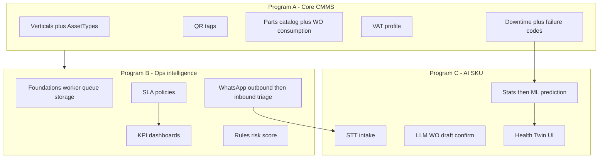

# Customer requirements roadmap (Orbit FMS)

**Phase:** sequenced delivery after A1–A2.  
**Leads consulted (plan):** Head of Product, Solution Architect, Contrarian + codebase explores.

## Program split

| Program | Customer promise | Sprints (2 eng) | Hardness |
|---------|------------------|-----------------|----------|
| **A** — Asset + billing core | Vertical templates, QR, parts on bill + VAT, downtime fields | S1–S6 (~12 weeks) | Medium |
| **B** — SLA/KPI + WhatsApp triage | SLA clocks, eng/tech KPIs, WA notify + human-triaged intake | S7–S12 (~12 weeks) | High (Meta + worker) |
| **C** — AI / Health Twin | STT, assistant draft WO, prediction, twin view | S13+ (data-gated) | High / uncertain |

**Customer framing:** commit A now; publish B as roadmap; C as separately priced AI SKU after ≥3–6 months of labelled WO/failure data.

## Sprint map

| Sprint | Focus | Delivers |
|--------|-------|----------|
| S0 | AgDRs + Meta start | Queue, storage, AssetType, QR URL, tax profile, WA |
| S1–S2 | A1 Verticals + AssetTypes | **Done** (PR #31) |
| S3 | A2 QR print + resolve | **Done** (PR #35) |
| S4–S5 | **A3–A4 Parts UI + WO parts + VAT** | Bill reflects qty × price × VAT — **ACTIVE** |
| S6 | A5 Downtime/failure + hardening | Pilot-ready Program A |
| S7–S8 | B0 Foundations | Worker, storage, events |
| S9–S10 | B1–B2 SLA + KPI | Eng/tech SLA KPIs |
| S11–S12 | B3 risk + B4 WA triage | Multi-source intake (human) |
| S13+ | C STT → LLM → stats → Health Twin | After data + flags |

## AgDRs required

1. Overturn year-1 non-goals (inventory + WhatsApp intake)
2. Job queue (Postgres `SKIP LOCKED` vs Redis/Celery)
3. Object storage provider
4. AssetType copy-on-adopt vs live reference — *done in A1*
5. QR public URL scheme — *done AgDR-A2*
6. **TaxProfile** (multi-country rates; e-invoice out of scope) — *A3–A4*
7. WhatsApp Cloud vs BSP
8. STT/LLM provider ports + PDPL
9. Digital Twin definition = Health Twin

## Material risks

| Risk | Severity | Mitigation |
|------|----------|------------|
| Digital Twin / ML with no failure history | Showstopper if sold as ML | Health Twin + rules; delay ML |
| VAT jurisdiction / e-invoice liability | High | Configurable VAT; e-invoice separate contract |
| Printed QR URL irreversible | High | AgDR-A2 + stable `PUBLIC_APP_URL` |
| Invoice `work_order_id` unique + `_sar` naming | Medium | Expand/contract + TaxProfile snapshot |
| Team capacity | High | Sequence A before B/C |
